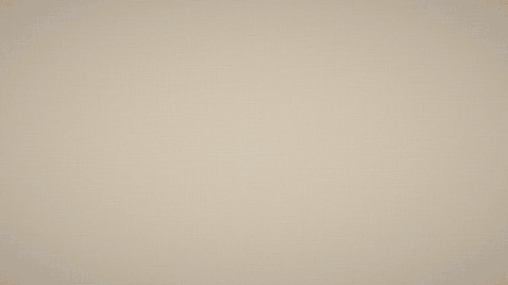
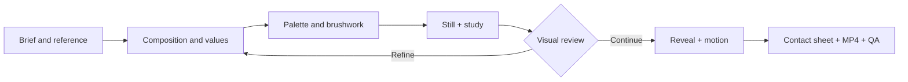
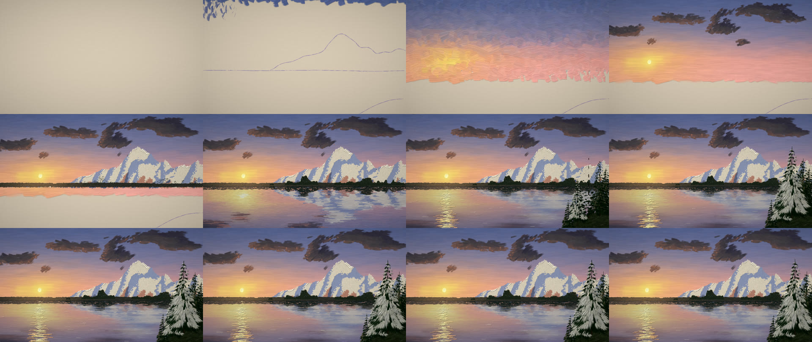
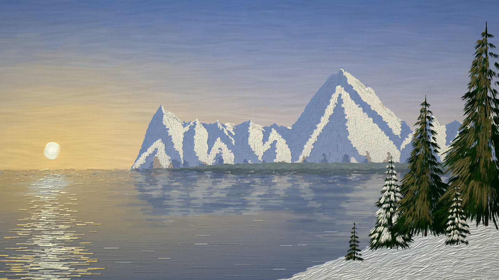
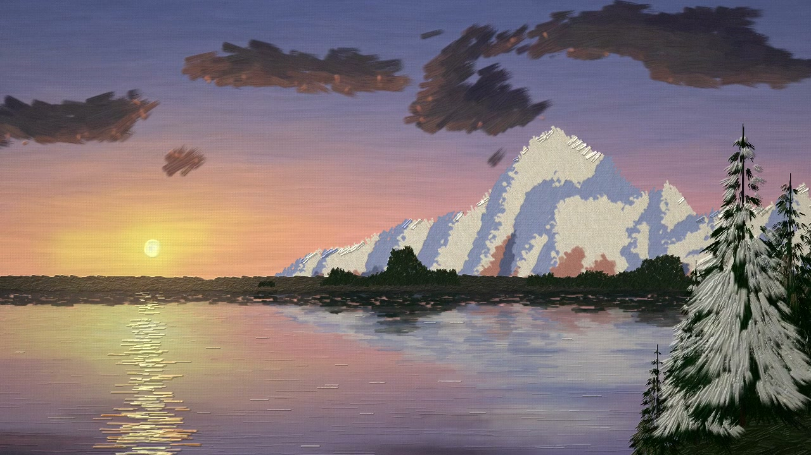
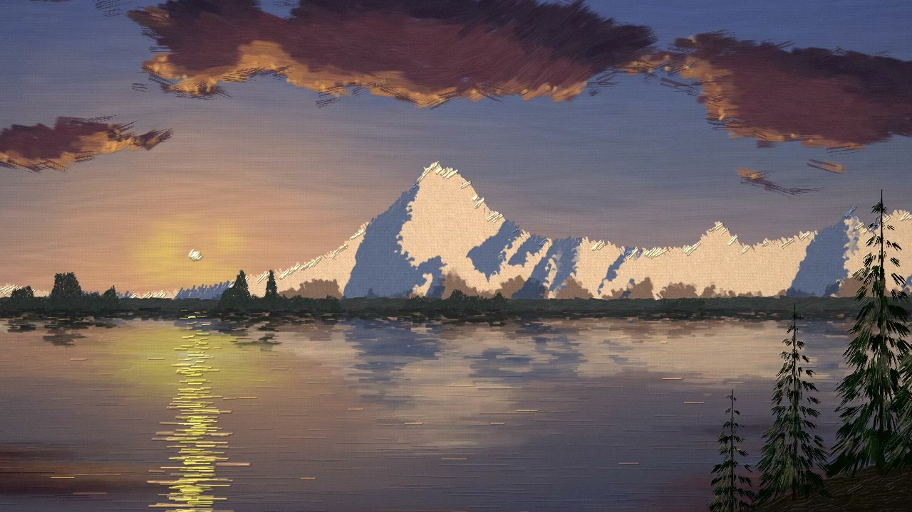
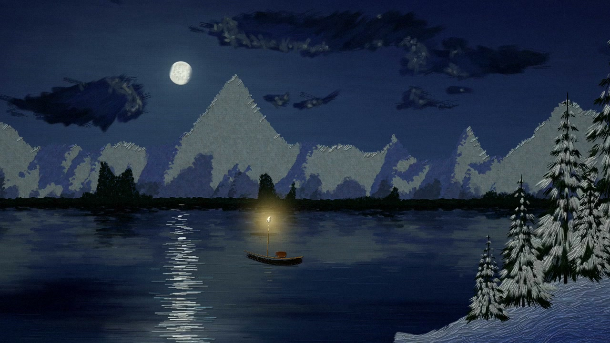
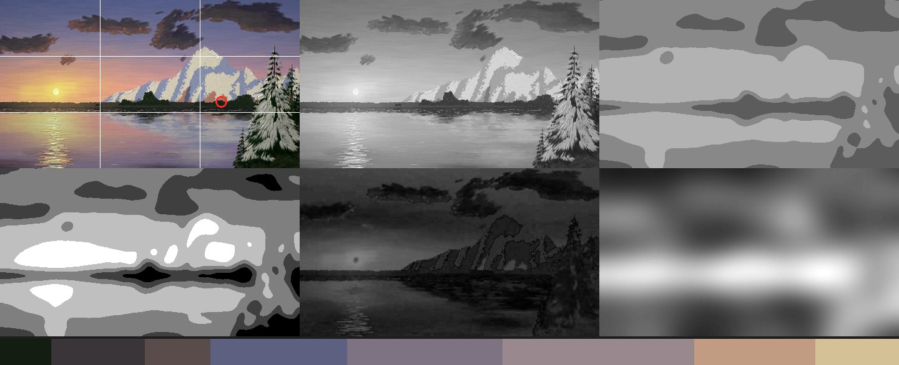
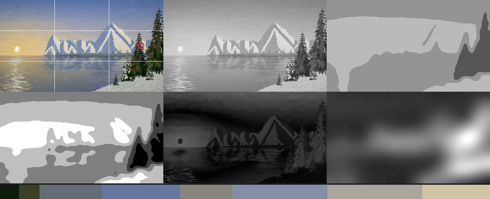
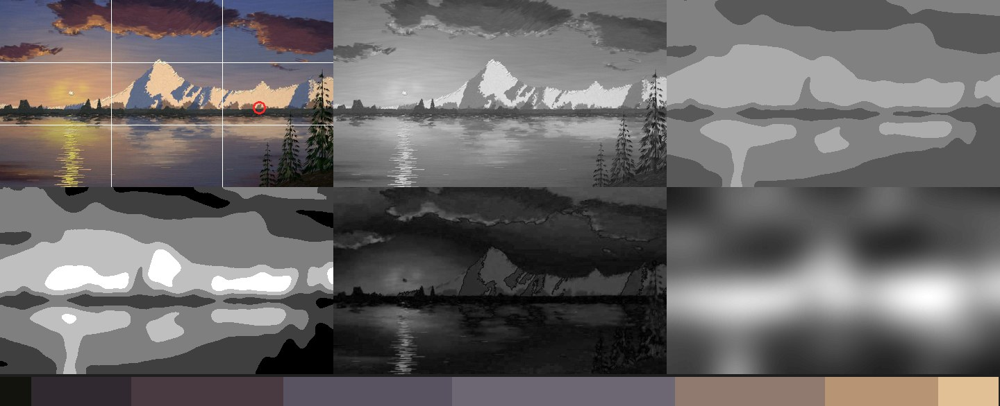

<div align="center">

<pre align="left">
          _    ___       _
  _ __   / \  |_ _|_ __ | |_ ___ _ __
 | '_ \ / _ \  | || '_ \| __/ _ \ '__|
 | |_) / ___ \ | || | | | ||  __/ |
 | .__/_/   \_\___|_| |_|\__\___|_|
 |_|
</pre>

# pAInter

**An agent skill for painting with code.**

From an idea to a living painting: composition, pigments, brushwork, and motion.

   

[Watch the process](#watch-the-process) · [Study](#study-understand-the-image) · [Install](#install-the-skill) · [Try it](#your-first-painting) · [Documentation](#inside-the-skill)

<a href="docs/media/sunset-lake.mp4"></a>

*Sunset Lake · 8 seconds · GIF preview · click to open the MP4.*

</div>

## The skill

**pAInter gives an agent a complete painting workflow:** plan the composition, establish value masses, mix pigments, place strokes from background to foreground, inspect the result, and refine it before adding motion.

The entry point is [SKILL.md](SKILL.md), registered as `painterly-video`. This repository includes the rendering engine, painting references, ten starter scenes, and an image study tool. The agent writes a JavaScript scene; the engine turns it into images and video with canvas texture, bristles, dry brush, and raised paint.

| Artistic decision | How the skill approaches it |
| :--- | :--- |
| **Where the eye goes** | Composition, three value masses, and a deliberate focal point. |
| **How the paint feels** | Strokes with paint load, thickness, softness, mixing, and direction. |
| **How the image appears** | Three openings, chosen at render time: *finished artwork* (default), the full *painting process*, or a *final pass* over the last details. |
| **How it comes alive** | Wind, clouds, water, dynamic subjects, and a parallax camera. |
| **How it is evaluated** | Stills, study sheets, timeline contact sheets, and MP4 analysis. |

Rendering runs locally and needs no image or video API keys. The agent writing and reviewing the scene uses its own model and environment.

### What a scene looks like

A scene is a plain JavaScript module. The agent mixes paint from named pigments, places each mix on a value plan, and paints back to front; the engine handles the brush, the canvas, and time.

```js
import { Painting, mix, tone, skyColor, paintSky, ridge, paintHills, paintGrass, key, ease } from 'painter';
export const meta = { duration: 16, fps: 30 };

export default function ({ aspect, seed }) {
  const p = new Painting({ aspect, seed, ground: '#c9b89a' });      // toned canvas, never white
  p.duration = 16;

  // palette: real pigment mixes, each placed at a planned value (0 black … 1 white)
  const skyTop = tone(mix({ ultramarine: 2, titaniumWhite: 2 }), 0.72);
  const skyLow = tone(mix({ cadmiumOrange: 1, titaniumWhite: 3 }), 0.88);
  const hillCol = tone(mix({ ultramarine: 1, burntUmber: 1 }), 0.3);

  p.phase('sky');                                                     // far to near, like a painter
  paintSky(p.layer('sky', { depth: 0 }), { color: skyColor({ top: 0, bottom: 0.7, stops: [[0, skyTop], [1, skyLow]] }), bottom: 0.72 });
  p.phase('land');
  paintHills(p.layer('hill', { depth: 0.6 }), { top: ridge({ y: 0.68, amp: 0.05, freq: 2, seed }), color: () => hillCol });
  paintGrass(p.layer('grass', { depth: 1 }), { bounds: [0, 0.8, aspect, 1.05], dark: hillCol, light: tone(hillCol, 0.5), blade: 0.05 });

  p.timelapse({ start: 0.3, end: 10 });                               // the painting process …
  p.camera = (t) => ({ zoom: key(t, [[p.livingStart, 1], [p.endTime, 1.07]], ease.inOut) });   // … then it comes alive
  p.wind = (t) => ({ strength: key(t, [[0, 0], [p.livingStart, 0.15], [p.livingStart + 2, 1]]) });
  return p;
}
```

The same scene renders in any format, length, and opening, chosen by flags; before painting, the agent asks for any of these the request leaves out:

| Option | Flag | Default |
| :--- | :--- | :--- |
| Format | `--size 1920x1080` · `1080x1920` · `1080x1080` · `3840x2160` | 16:9 |
| Duration | `--duration 15` | 15 s |
| Opening | `--opening finished` (complete on the first frame) · `paint-on` (painted stroke by stroke) · `final-pass` (only the last details are painted) | `finished` |

Ready-made painters cover skies, sun and moon, cumulus and storm clouds, rays, hills, mountains, water, trees, firs, pines, grass, rocks, houses, boats, figures, and smoke; anything else is built from `layer.stroke`, `layer.scatter`, and `layer.path`. See the [Engine API](references/api.md).

## Watch the process

The workflow connects artistic decisions with visual checks:



### From canvas to scene

<a href="docs/media/sunset-lake-timeline.jpg"></a>

A contact sheet makes the pacing visible: drawing, sky, masses, detail, and the living painting. Each scene defines its phases and how much time they receive.

<details>
<summary><strong>Watch another sequence: Last Light</strong></summary>

<a href="docs/media/last-light.mp4"></a>

[Watch or download the MP4 · 10 s](docs/media/last-light.mp4)

GIF previews use 640 px and 10 fps. The MP4s retain 1280 × 720 at 30 fps, compressed for this documentation. Video preserves more of the water motion and brushwork.

</details>

### Recent results

**All four were painted by agents that had never seen the skill before**: each one received only this folder and a one-paragraph brief, read SKILL.md, wrote its own scene, critiqued its stills, and delivered the video. These cold tests are how the skill was validated; the ten files in `examples/` are starter scenes.

<table>
<tr>
<td width="50%"><a href="docs/media/alps-morning.jpg"></a><br><strong>Alps Morning</strong><br>Morning light · latest available still · <a href="docs/media/studies/alps-morning_study.jpg">study</a></td>
<td width="50%"><a href="docs/media/sunset-lake.mp4"></a><br><strong>Sunset Lake</strong><br>Sunset · 8 s · <a href="docs/media/sunset-lake.mp4">MP4</a> · <a href="docs/media/studies/sunset-lake_study.jpg">study</a></td>
</tr>
<tr>
<td width="50%"><a href="docs/media/last-light.mp4"></a><br><strong>Last Light</strong><br>Last light · 10 s · <a href="docs/media/last-light.mp4">MP4</a> · <a href="docs/media/studies/last-light_study.jpg">study</a></td>
<td width="50%"><a href="docs/media/blue-hour-lake.mp4"></a><br><strong>Blue Hour Lake</strong><br>Blue hour · 10 s · <a href="docs/media/blue-hour-lake.mp4">MP4</a></td>
</tr>
</table>

Alps Morning did not yet have an MP4 in the source collection. The other three posters were extracted from their final videos to keep them aligned with the latest corrections. [Media provenance and preparation](docs/media/README.md).

## Study: understand the image

Before adding detail, the skill examines whether the painting works as a set of shapes and values. [tools/study.py](tools/study.py) produces a six-panel study sheet, a proportional palette, and JSON metrics.

<a href="docs/media/studies/sunset-lake_study.jpg"></a>

| Top row, left to right | Bottom row, left to right |
| :--- | :--- |
| Original, thirds, and estimated focal point | Five-value simplification |
| Grayscale lightness | Chroma map |
| Three value masses (*notan*) | Estimated focal map |

The strip below shows colors in proportion to their share of the image. The focal map is a **contrast-and-chroma heuristic** for visual critique, not an eye-tracking measurement.

<details>
<summary><strong>Compare studies: morning and last light</strong></summary>

**Alps Morning** — broad, cool light across snow masses.



**Last Light** — a warm accent within a darker structure.



[Explore the metrics for all three images](docs/media/studies/_metrics.json).

</details>

## Install the skill

### Requirements

- **Node.js 22.12 or later**, matching the included Puppeteer version. [Puppeteer requirements](https://pptr.dev/guides/system-requirements).
- **Google Chrome with WebGPU**. Set `CHROME_PATH` to use a different installation path.
- **ffmpeg and ffprobe**, for video processing, contact sheets, and QA.
- **Python 3** with `numpy`, `Pillow`, and `scikit-learn` if you use the study tool.

The workflow was developed on macOS with Apple Silicon. The CLI includes Chrome paths for Linux and Windows, but those platforms need validation on their own hardware. Codec availability depends on the browser and machine.

### In Claude Code

Clone the repository into a new skill directory:

```bash
git clone https://github.com/ninjasweb/painter-skill.git \
  ~/.claude/skills/painterly-video

# install the engine's dependencies once (Puppeteer, Mediabunny)
npm ci --prefix ~/.claude/skills/painterly-video/engine

# optional: the study tool
python3 -m venv ~/.claude/skills/painterly-video/.venv
~/.claude/skills/painterly-video/.venv/bin/python -m pip install \
  -r ~/.claude/skills/painterly-video/tools/requirements.txt
```

Start a new Claude Code session afterwards so the skill is listed. Check that everything works by rendering one still:

```bash
cd ~/.claude/skills/painterly-video
node engine/bin/paint.mjs still examples/brush-chart.js --t 4
```

A PNG in `examples/stills/brush-chart/` means Chrome, WebGPU, and the engine are ready. If you already have an installation, preserve local changes before updating. For another agent that supports SKILL.md skills, place this folder in its skills directory and keep the engine, examples, references, and tools alongside the entry point.

### Give the agent an intention

> Use painterly-video to paint an alpine lake at sunset. Make an 8-second, 16:9 video: first the painting builds up, then the clouds and water move gently. Study the values, review a still, and deliver an MP4, a poster, and a contact sheet.

You can also ask it to study a reference image, design a vertical scene, or refine an existing painting. Full composition and review instructions live in [SKILL.md](SKILL.md).

## Your first painting

To explore the engine directly, clone into a new directory and run from the repository root:

```bash
git clone https://github.com/ninjasweb/painter-skill.git
cd painter-skill
npm ci --prefix engine

# Finished painting: examples/stills/sunset-river/t016.00.png
node engine/bin/paint.mjs still examples/sunset-river.js --t 16

# Interactive preview: open the printed local URL in Chrome
node engine/bin/paint.mjs preview examples/sunset-river.js
```

The preview includes playback and a time scrubber. Reload after editing the scene; Ctrl+C stops the server.

<details>
<summary><strong>Export an MP4 and inspect its timeline</strong></summary>

From the repository root:

```bash
# Twelve moments from the process, plus a contact sheet
node engine/bin/paint.mjs still examples/sunset-river.js --n 12 --sheet --opening paint-on

# Shareable MP4: H.264, yuv420p, bt709 — finished artwork, 15 s
node engine/bin/paint.mjs render examples/sunset-river.js \
  --size 1280x720 --duration 15 --compat

# The same scene, showing the painting process
node engine/bin/paint.mjs render examples/sunset-river.js \
  --size 1280x720 --opening paint-on --compat --out examples/out/sunset-river-process.mp4

# Automated report: inspect the JSON "ok" field
node engine/bin/paint.mjs qa examples/out/sunset-river.mp4
```

QA checks frame counts, sudden changes, and black segments, and reports frozen frames. Visual review is still necessary: weak composition can pass technical checks.

</details>

<details>
<summary><strong>Generate your own study sheet</strong></summary>

From the repository root:

```bash
python3 -m venv .venv
.venv/bin/python -m pip install -r tools/requirements.txt
.venv/bin/python tools/study.py \
  examples/stills/sunset-river/t016.00.png --out study
```

This writes `study/t016.00_study.jpg` and `study/_metrics.json`. On Windows, use the Python executable under `.venv/Scripts/`.

</details>

<details>
<summary><strong>Choose a starter scene</strong></summary>

| File | What to explore |
| :--- | :--- |
| [sunset-river.js](examples/sunset-river.js) | Sky, cumulus clouds, reflections, and vegetation. |
| [sunset-study.js](examples/sunset-study.js) | Dark cloud masses and illuminated edges. |
| [lake-path.js](examples/lake-path.js) | Depth, trees, and a path that leads the eye. |
| [lone-pine.js](examples/lone-pine.js) | A vertical subject, branches, and needle masses. |
| [mountain-hamlet.js](examples/mountain-hamlet.js) | Mountains, a cabin, rocks, a walking figure, and smoke. |
| [from-photo.js](examples/from-photo.js) | Painting from a photo with `paintFrom`: value masses, form, and detail around a focal point. |
| [sea-pier.js](examples/sea-pier.js) | A storm at sunset after Aivazovsky: a modelled sea, a pier, and a woman painted from a photo. |
| [people-landscape.js](examples/people-landscape.js) | Real people: one painted from a photo, one mannequin with a real pose. |
| [figure-chart.js](examples/figure-chart.js) | People: the five construction stages of a pose, and seven finished poses. |
| [brush-chart.js](examples/brush-chart.js) | Brushes, textures, and pigment mixes. |

These examples remain starting points; the README gallery shows later work.

</details>

## Inside the skill

```text
painter-skill/
├── SKILL.md              Agent instructions and painting workflow
├── engine/               WebGPU engine, shaders, pigments, and CLI
├── examples/             Ten starter JavaScript scenes and reference photos
├── references/           Composition, painting, API, animation, and pipeline
├── tools/                Image study, person reader (pose and masks), Python dependencies
└── docs/                 Skill review and gallery media
```

| Read | Purpose |
| :--- | :--- |
| [Skill instructions](SKILL.md) | Understand the workflow and artistic judgment. |
| [Composition](references/composition.md) | Plan values, palette, and focal point. |
| [Painting lessons](references/painting-lessons.md) | Translate painting gestures into code. |
| [Engine API](references/api.md) | Layers, brushes, pigments, and scene functions. |
| [Sea](references/sea.md) | Waves after Aivazovsky: a modelled sea painted with his palette, glow, and foam. |
| [Perspective](references/perspective.md) | Horizon and eye level, sizing things by distance, vanishing points, atmospheric depth. |
| [Figures](references/figures.md) | People: construction, proportions, skin, and poses. |
| [Animation](references/animation.md) | Reveal, motion, camera, and dynamic subjects. |
| [Pipeline](references/pipeline.md) | CLI, export, performance, and troubleshooting. |
| [Technical review](docs/skill-review.md) | Strengths, limitations, and publication checks. |

The engine combines **WebGPU/WGSL** for strokes, **spectral.js** for pigment mixing, **WebCodecs + Mediabunny** for MP4 encoding, and **ffmpeg** for compatibility and analysis. A scene depends on its seed and time, so it can be rendered again at different sizes.

## Credits

The skill brings together instructions, implementation, and painting studies. Its references acknowledge demonstrations by Alpay Efe, A Lu Art, Thomas Windsor, and Andrew Tischler, alongside studies of classic landscapes. The sea guide draws on Ivan Aivazovsky's paintings (public domain) and on lessons by Alexander Yakov, Aiymoonchild, and Daria Mars. The perspective guide draws on lessons by Rocky Kim (as summarised by brokendraw), Kim Jung Gi, Proko, Ian Roberts, and James Gurney, and on measurements of paintings by Caillebotte, Seurat, and Bruegel. The figure guide draws on anatomy lessons by Fungzau, NIRO, and Sinix Design, and on public-domain plates by George Bridgman, John Vanderpoel, Leonardo da Vinci, and Eadweard Muybridge. The gallery contains results generated in the working project; downloaded reference videos are not included.

The reference photos in `examples/refs/` are CC0 from Wikimedia Commons (Unsplash uploads): "Hiking in the Dolomites" (`hiker.jpg`), "Woman in a dress" (`woman-dress.jpg`), and the pose of "Woman walking on a sand beach" (`walker.person.json`). `mountain-lake.jpg` is ["Beautiful mountain reflection (Unsplash)"](https://commons.wikimedia.org/wiki/File:Beautiful_mountain_reflection_(Unsplash).jpg) from Wikimedia Commons, dedicated to the public domain (CC0). The painting-from-reference method follows Aaron Hertzmann's "Painterly Rendering with Curved Brush Strokes of Multiple Sizes" (SIGGRAPH 1998), with value massing, a focal detail budget, and edge rules added.

**spectral.js**, by Ronald van Wijnen, retains its [original MIT license](engine/src/vendor/spectral.LICENSE). Dependencies retain their own licenses. A repository-wide license for the original code and media has not yet been declared.

---

<div align="center">

**Compose. Paint. Look. Refine. Animate.**

[Back to top](#painter)

</div>
