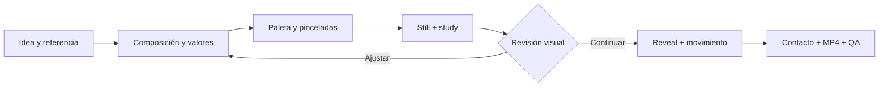

<div align="center">

<pre>
          _    ___       _
  _ __   / \  |_ _|_ __ | |_ ___ _ __
 | '_ \ / _ \  | || '_ \| __/ _ \ '__|
 | |_) / ___ \ | || | | | ||  __/ |
 | .__/_/   \_\___|_| |_|\__\___|_|
 |_|
</pre>

# pAInter

**Una skill para agentes que pintan con código.**

De una idea a una pintura animada: composición, pigmentos, pinceladas y movimiento.


[Ver el proceso](#ver-el-proceso) · [Study](#study-entender-la-imagen) · [Instalar](#instalar-la-skill) · [Probar](#primera-pintura) · [Documentación](#dentro-de-la-skill)

<a href="docs/media/sunset-lake.mp4"></a>

*Sunset Lake · 8 segundos · preview GIF · pulsa para abrir el MP4.*

</div>

## La skill

**pAInter enseña al agente un proceso de pintura completo:** planear la composición, distribuir las masas de valor, mezclar pigmentos, colocar pinceladas de fondo a primer plano, mirar el resultado y corregirlo antes de animar.

El punto de entrada es [`SKILL.md`](SKILL.md), con el nombre técnico `painterly-video`. El repositorio incluye el motor, las referencias de pintura, seis escenas de partida y una herramienta para estudiar imágenes. El agente escribe una escena JavaScript; el motor la convierte en imágenes y video con textura de lienzo, cerdas, pincel seco y relieve de pintura.

| Decisión artística | Cómo la resuelve la skill |
| :--- | :--- |
| **Qué mirar primero** | Composición, tres masas de valor y un punto focal deliberado. |
| **Cómo se siente la pintura** | Pinceladas con carga, grosor, suavidad, mezcla y dirección. |
| **Cómo aparece** | Un *paint-on reveal* que distribuye las pinceladas por fases. |
| **Cómo cobra vida** | Viento, nubes, agua, elementos dinámicos y cámara con paralaje. |
| **Cómo se evalúa** | Stills, láminas `study`, hojas de contacto y análisis del MP4. |

El renderizado es local y no requiere claves de una API de imágenes o video. El agente que escribe y revisa la escena utiliza su propio entorno y modelo.

## Ver el proceso

El flujo une decisiones artísticas y comprobaciones visuales:



### Del lienzo a la escena

<a href="docs/media/sunset-lake-timeline.jpg"></a>

La hoja de contacto permite revisar el ritmo: dibujo, cielo, masas, detalles y pintura viva. Cada escena define sus fases y el tiempo que dedica a ellas.

<details>
<summary><strong>Ver otra secuencia: Last Light</strong></summary>

<a href="docs/media/last-light.mp4"></a>

[Ver o descargar MP4 · 10 s](docs/media/last-light.mp4)

Los GIFs son previews a 640 px y 10 fps. Los MP4 mantienen 1280 × 720 y 30 fps, comprimidos para la documentación. El video conserva mejor los detalles del agua y las pinceladas.

</details>

### Resultados recientes

Estas muestras proceden de las últimas iteraciones del trabajo realizado con la skill. Son demostraciones del flujo; los seis archivos de `examples/` son las escenas base para empezar.

<table>
<tr>
<td width="50%"><a href="docs/media/alps-morning.jpg"></a><br><strong>Alps Morning</strong><br>Luz de mañana · último still disponible · <a href="docs/media/studies/alps-morning_study.jpg">study</a></td>
<td width="50%"><a href="docs/media/sunset-lake.mp4"></a><br><strong>Sunset Lake</strong><br>Atardecer · 8 s · <a href="docs/media/sunset-lake.mp4">MP4</a> · <a href="docs/media/studies/sunset-lake_study.jpg">study</a></td>
</tr>
<tr>
<td width="50%"><a href="docs/media/last-light.mp4"></a><br><strong>Last Light</strong><br>Última luz · 10 s · <a href="docs/media/last-light.mp4">MP4</a> · <a href="docs/media/studies/last-light_study.jpg">study</a></td>
<td width="50%"><a href="docs/media/blue-hour-lake.mp4"></a><br><strong>Blue Hour Lake</strong><br>Hora azul · 10 s · <a href="docs/media/blue-hour-lake.mp4">MP4</a></td>
</tr>
</table>

Alps Morning todavía no dispone de un MP4 en la selección original. Las otras tres imágenes se extrajeron de sus videos finales para mantenerlas sincronizadas con las correcciones. [Procedencia y preparación de los medios](docs/media/README.md).

## Study: entender la imagen

Antes de añadir más detalle, la skill analiza si la pintura funciona como un conjunto de formas y valores. [`tools/study.py`](tools/study.py) genera una lámina de seis paneles, una paleta proporcional y métricas en JSON.

<a href="docs/media/studies/sunset-lake_study.jpg"></a>

| Arriba, de izquierda a derecha | Abajo, de izquierda a derecha |
| :--- | :--- |
| Original, tercios y foco estimado | Simplificación en cinco valores |
| Luminosidad en escala de grises | Mapa de croma |
| Tres masas de valor (*notan*) | Mapa focal estimado |

La franja inferior muestra los colores y su proporción. El foco es una **estimación de contraste y croma**, una ayuda para la crítica visual; no es una medición del movimiento de los ojos.

<details>
<summary><strong>Comparar estudios: mañana y última luz</strong></summary>

**Alps Morning** — una luz amplia y fría sobre masas de nieve.


**Last Light** — un acento cálido sobre una estructura más oscura.


[Consultar las métricas de las tres imágenes](docs/media/studies/_metrics.json).

</details>

## Instalar la skill

### Requisitos

- **Node.js 22.12 o superior**, de acuerdo con la versión de Puppeteer incluida. [Requisitos de Puppeteer](https://pptr.dev/guides/system-requirements).
- **Google Chrome con WebGPU**. Se puede indicar otra ubicación con `CHROME_PATH`.
- **ffmpeg y ffprobe**, para procesar video, crear hojas de contacto y ejecutar QA.
- **Python 3**, con `numpy`, `Pillow` y `scikit-learn`, si se utilizará `study.py`.

El flujo está documentado a partir de macOS con Apple Silicon. Linux y Windows tienen rutas de Chrome contempladas en el CLI, pero necesitan validación en su propio hardware. La disponibilidad de codecs depende del navegador y del equipo.

### En Claude Code

Clona el repositorio en una carpeta nueva de skills:

```bash
git clone https://github.com/ninjasweb/painter-skill.git \
  ~/.claude/skills/painterly-video
```

Si ya tienes una instalación, conserva sus cambios antes de actualizarla. Para otro agente que admita skills con `SKILL.md`, coloca esta carpeta en su directorio de skills y conserva `engine/`, `examples/`, `references/` y `tools/` junto a ella.

### Dale una intención al agente

> Usa painterly-video para pintar un lago alpino al atardecer. Quiero un video de 8 segundos en 16:9: primero se construye la pintura y después se mueven suavemente las nubes y el agua. Estudia los valores, revisa un still y entrega MP4, poster y hoja de contacto.

También puedes pedirle que estudie una imagen de referencia, que diseñe una escena vertical o que refine una pintura existente. Las instrucciones completas de composición y revisión están en [`SKILL.md`](SKILL.md).

## Primera pintura

Para explorar el motor directamente, clona el repositorio en una carpeta nueva y ejecuta desde su raíz:

```bash
git clone https://github.com/ninjasweb/painter-skill.git
cd painter-skill
npm ci --prefix engine

# Pintura terminada: examples/stills/sunset-river/t016.00.png
node engine/bin/paint.mjs still examples/sunset-river.js --t 16

# Preview interactiva: abre la dirección local impresa en Chrome
node engine/bin/paint.mjs preview examples/sunset-river.js
```

La preview incluye reproducción y control de tiempo. Recarga después de editar la escena; `Ctrl+C` cierra el servidor.

<details>
<summary><strong>Exportar un MP4 y revisar su timeline</strong></summary>

Desde la raíz del repositorio:

```bash
# Doce momentos del proceso y una hoja de contacto
node engine/bin/paint.mjs still examples/sunset-river.js --n 12 --sheet

# MP4 para compartir: H.264, yuv420p, bt709
node engine/bin/paint.mjs render examples/sunset-river.js \
  --size 1280x720 --fps 30 --compat

# Informe automático; revisar el campo "ok" del JSON
node engine/bin/paint.mjs qa examples/out/sunset-river.mp4
```

QA revisa el conteo de frames, cambios bruscos y segmentos negros, y reporta frames congelados. El resultado necesita además revisión visual: una composición débil puede superar los controles técnicos.

</details>

<details>
<summary><strong>Generar tu propia lámina study</strong></summary>

Desde la raíz del repositorio:

```bash
python3 -m venv .venv
.venv/bin/python -m pip install -r tools/requirements.txt
.venv/bin/python tools/study.py \
  examples/stills/sunset-river/t016.00.png --out study
```

Obtendrás `study/t016.00_study.jpg` y `study/_metrics.json`. En Windows, utiliza el ejecutable de Python de `.venv/Scripts/`.

</details>

<details>
<summary><strong>Elegir una escena base</strong></summary>

| Archivo | Qué permite explorar |
| :--- | :--- |
| [`sunset-river.js`](examples/sunset-river.js) | Cielo, cúmulos, reflejos y vegetación. |
| [`sunset-study.js`](examples/sunset-study.js) | Masas de nubes oscuras y bordes iluminados. |
| [`lake-path.js`](examples/lake-path.js) | Profundidad, árboles y un camino como guía visual. |
| [`lone-pine.js`](examples/lone-pine.js) | Un sujeto vertical, ramas y masas de agujas. |
| [`mountain-hamlet.js`](examples/mountain-hamlet.js) | Montañas, cabaña, rocas, figura caminando y humo. |
| [`brush-chart.js`](examples/brush-chart.js) | Pinceles, texturas y mezclas de pigmentos. |

Los ejemplos conservan su papel de punto de partida; la galería de este README usa trabajos posteriores.

</details>

## Dentro de la skill

```text
painter-skill/
├── SKILL.md              Instrucciones y flujo de trabajo del agente
├── engine/               Motor WebGPU, shaders, pigmentos y CLI
├── examples/             Seis escenas JavaScript de partida
├── references/           Composición, pintura, API, animación y pipeline
├── tools/                Análisis de imágenes y dependencias Python
└── docs/                 Revisión de la skill y medios de la galería
```

| Leer | Para qué |
| :--- | :--- |
| [Instrucciones de la skill](SKILL.md) | Entender el flujo y el criterio artístico. |
| [Composición](references/composition.md) | Planear valores, paleta y punto focal. |
| [Lecciones de pintura](references/painting-lessons.md) | Traducir gestos pictóricos a código. |
| [API del motor](references/api.md) | Capas, pinceles, pigmentos y funciones de escena. |
| [Animación](references/animation.md) | Reveal, movimiento, cámara y elementos dinámicos. |
| [Pipeline](references/pipeline.md) | CLI, exportación, rendimiento y diagnóstico. |
| [Revisión técnica](docs/skill-review.md) | Fortalezas, límites y comprobaciones de publicación. |

El motor combina **WebGPU/WGSL** para las pinceladas, **spectral.js** para la mezcla de pigmentos, **WebCodecs + Mediabunny** para el MP4 y **ffmpeg** para compatibilidad y análisis. Una escena depende de su semilla y del tiempo: se puede volver a renderizar en distintos tamaños.

## Créditos

La skill reúne instrucciones, implementación y estudios de pintura. Sus referencias reconocen las demostraciones de Alpay Efe, A Lu Art, Thomas Windsor y Andrew Tischler, y el análisis de paisajes clásicos. La galería muestra resultados generados en el proyecto de trabajo; no incluye los videos de referencia descargados.

`spectral.js`, de Ronald van Wijnen, se distribuye con su [licencia MIT original](engine/src/vendor/spectral.LICENSE). Las dependencias conservan sus propias licencias. Este repositorio todavía no declara una licencia general para el código y los medios originales.

---

<div align="center">

**Componer. Pintar. Mirar. Ajustar. Animar.**

[Volver al inicio](#painter)

</div>
